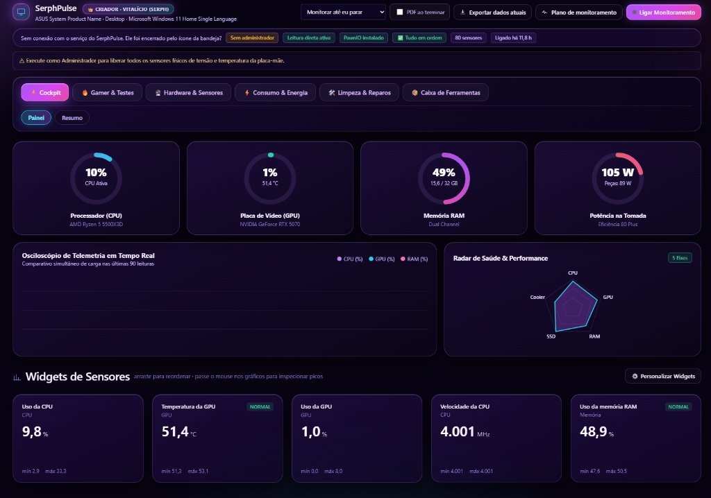
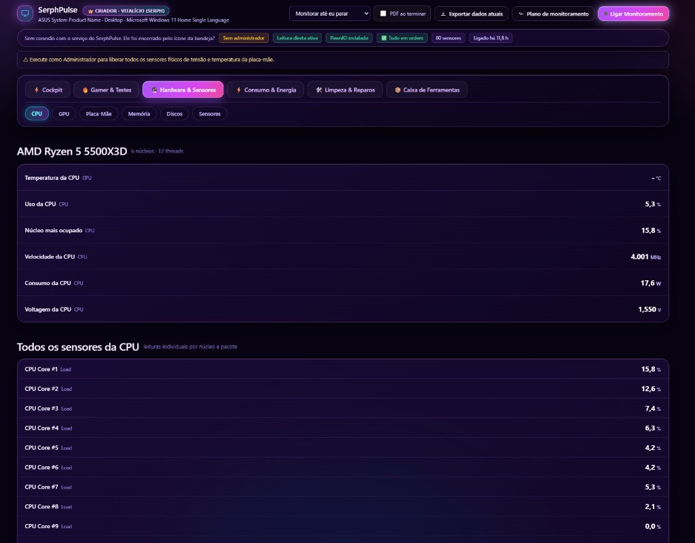

# SerphPulse v1.0

**Monitoramento de hardware em tempo real e otimizador para jogos no Windows**

🌐 **Site Oficial:** [https://serphpulse.vercel.app](https://serphpulse.vercel.app) · 📦 **Download Direto (v1.0.0):** [Baixar nas Releases](https://github.com/Luanserph/serphpulse/releases/latest)

[-ec4899?style=flat-square)](#a-ideia-por-trás-do-projeto)

---

## 💬 A ideia por trás do projeto

Fala pessoal! Aqui é o **Luan (Serph)**.

Eu sou formado na área de **Desenvolvimento de Sistemas** e sempre curti acompanhar de perto temperaturas, consumo de energia e frametime enquanto jogo no PC. Com o avanço absurdo das ferramentas de IA para programação nos últimos meses, eu quis fazer um teste prático de verdade: **será que dá para construir um software completo, mexendo com sensores físicos de hardware e APIs do Windows, 100% no formato de *Vibe Coding* (guiando a IA com base na minha bagagem técnica)?**

O resultado desse experimento é o **SerphPulse**.

Em vez de ficar só em um CRUD básico, fui puxando o projeto para resolver coisas reais do dia a dia no Windows: ler os sensores da placa-mãe/CPU/GPU sem travar a interface, limpar aquela memória *Standby* que o Windows acumula e dá *stutter* em jogos pesados, estimar quanto o PC está gastando na tomada em Watts (e em Reais no fim do mês) e até montar um fluxo completo de licenciamento por hardware (`HWID`) com pagamento automatizado.

---

## 🖥️ Como ficou a interface

A interface roda localmente de forma super leve, com visual escuro em tons de roxo e neon, atualizando os gráficos em tempo real sem piscar a tela:

### Painel Principal (Cockpit, Osciloscópio e Radar)

### Leitura por Núcleo (CPU, Clocks, Potência e Tensão)

### Consumo Elétrico na Tomada e Estimativa Mensal

### Seleção de Sensores e Relatório (+120 métricas disponíveis)

---

## 🎮 Detecção de Jogos e Otimização

Na aba **Modo Gamer**, o aplicativo varre automaticamente as bibliotecas instaladas no PC (**Steam**, **Xbox Game Pass**, **Epic Games** e **Riot**), puxa a arte de capa oficial do jogo e aplica ajustes práticos (como limpeza de *Working Set / Standby List* da RAM e plano de energia de alto desempenho).

Alguns dos jogos que usamos como base nos perfis de telemetria:
- **Cyberpunk 2077**
- **Call of Duty: Warzone / Modern Warfare 4**
- **Phantom Blade Zero** ([Steam](https://store.steampowered.com/app/4115450/Phantom_Blade_Zero/))
- **Black Myth: Wukong**, **Elden Ring**, **Counter-Strike 2**, **Red Dead Redemption 2**, **GTA V / FiveM**, **Forza Horizon 5** e **Baldur's Gate 3**.

---

## 🛠️ Arquitetura e Stack

Para quem tiver curiosidade técnica sobre como ele funciona por baixo do capô (o código-fonte principal em C# está na pasta [`src/`](src/)):

- **Backend Local (`C# / .NET`):** Roda um servidor local enxuto em `127.0.0.1` que conversa diretamente com o hardware via `LibreHardwareMonitorLib`, `PawnIO`, consultas `WMI` e chamadas nativas da API do Windows (`psapi.dll` para limpeza de páginas de memória e `powercfg` para planos de energia).
- **Frontend (`HTML5 / CSS3 / Vanilla JS`):** Renderização *in-place* em `<canvas>` (velocímetros, osciloscópio multi-linha e radar de 5 eixos) com detecção automática do idioma do sistema (**Português**, **Inglês** e **Espanhol**).
- **Empacotamento Portátil:** A versão das *Releases* já leva o runtime assinado da Microsoft embutido, então o usuário final não precisa instalar o SDK do .NET para abrir.

---

## 🚀 Como rodar no seu PC

1. Acesse o site oficial em **[serphpulse.vercel.app](https://serphpulse.vercel.app)** ou vá direto na aba [**Releases**](https://github.com/Luanserph/serphpulse/releases/latest) aqui do GitHub e baixe o `SerphPulse_v1.0.0_Oficial.zip`.
2. Extraia a pasta do `.zip` em qualquer lugar do seu computador.
3. Clique duas vezes no arquivo **`Iniciar_SerphPulse.bat`** *(dica: rodar como Administrador libera todos os sensores de tensão e temperatura da placa-mãe)*.

---

## ☕ Versão Gratuita vs. Apoio ao Projeto (PRO)

Toda a parte de monitoramento de sensores, painel, resumo de saúde do PC, cálculo de consumo elétrico e limpeza básica é **100% gratuita** na versão Demo.

Para testar também um fluxo real de micro-SaaS no projeto, coloquei a opção de desbloquear as ferramentas extras (**Modo Gamer Turbo**, **Benchmark Raio-X**, **Teste de Estresse** e **Reparos Avançados**) pagando um café simbólico de **R$ 10,00** (ou **$ 3.00 USD** para quem estiver fora do Brasil), com geração automática da chave na hora dentro do próprio app:

- **PIX (Chave E-mail ou QR Code direto no app):** `luan_serph@yahoo.com.br`
- **Cartão / Mercado Pago:** [https://mpago.la/2g2aauS](https://mpago.la/2g2aauS)
- **Internacional (Wise — USD / EUR / GBP):** [https://wise.com/pay/r/c1z0yx30_Dyyaz0](https://wise.com/pay/r/c1z0yx30_Dyyaz0)

---

## 🇺🇸 Quick Note for International Users

Hi! I'm **Luan ("Serph")**, a Software Development graduate from Brazil. I built **SerphPulse** as a hands-on **100% Vibe Coding (AI-assisted engineering)** experiment to see how far AI + software architecture knowledge could go when building a real low-level Windows hardware telemetry and gaming optimization tool.

The app automatically detects your Windows language (**English**, **Spanish**, or **Portuguese**). You can download the portable `.zip` from [**Releases**](https://github.com/Luanserph/serphpulse/releases/latest) or visit **[serphpulse.vercel.app](https://serphpulse.vercel.app)**.

---

  Feito com ☕ por <b>Luan "Serph"</b> · <a href="mailto:luan_serph@yahoo.com.br">luan_serph@yahoo.com.br</a>

