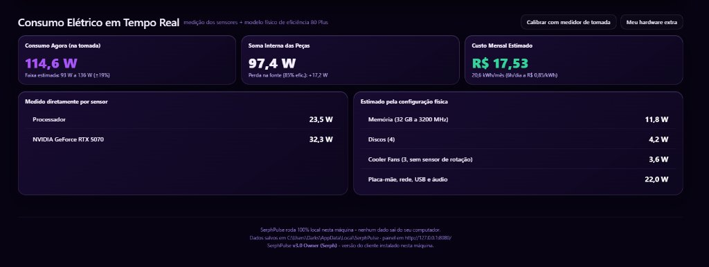
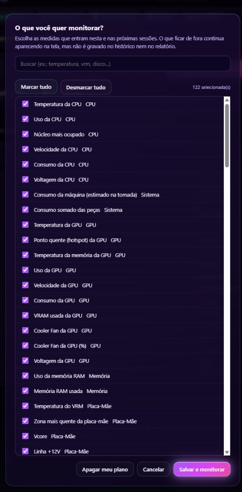

# ⚡ SerphPulse v1.0 — Gaming Optimizer & Real-Time Hardware Telemetry

**Telemetria Cyberpunk em Tempo Real · Modo Gamer Turbo · Limpeza de Standby RAM · Benchmark Raio-X**

[-ec4899?style=for-the-badge)](#como-usar)

[**🇧🇷 Português**](#-sobre-o-projeto--100-vibe-coding) · [**🇺🇸 English**](#-english-overview--100-vibe-coding-experiment)

---

## 🧠 Sobre o Projeto — 100% Vibe Coding & Engenharia Assistida por IA

Olá! Eu sou **Luan ("Serph")**, **formado na área de Desenvolvimento de Sistemas**, e decidi criar o **SerphPulse v1.0** com um objetivo claro: colocar à prova até onde é possível chegar construindo um software desktop/web completo, de baixo nível e pronto para comercialização usando **100% Vibe Coding (desenvolvimento 100% guiado por Inteligência Artificial sob direção técnica de um desenvolvedor formado)**.

Em vez de criar apenas um projetinho simples, desafiei a IA a construir junto comigo uma aplicação real de **telemetria física de hardware e otimização gamer para Windows**, integrando:
- **Leitura direta de sensores físicos de baixo nível** (`LibreHardwareMonitor` + `PawnIO` + `WMI` + `Win32 API`);
- **Interface Cyberpunk / Glassmorphism a 60 FPS sem piscadas (*Zero-Flicker In-Place DOM Engine*)**;
- **Detecção automática de jogos instalados** (*Steam*, *Xbox Game Pass*, *Epic Games*, *Riot Games*) com carregamento automático da arte oficial de capa;
- **Criptografia Anti-Vazamento vinculada ao Hardware (`HMAC-SHA256` sobre `HWID`)** + sistema de transferência gratuita caso o usuário troque de computador;
- **Checkout automatizado em tempo real** integrado à API oficial do **Mercado Pago (PIX QR Code do Banco Central + Cartão)** e **Wise Internacional**, gerando e ativando a chave do usuário em 3 segundos!

---

## 🖥️ Prints Reais do SerphPulse v1.0

### 1. ⚡ Cockpit Neon, Velocímetros Radiais, Osciloscópio & Radar 5 Eixos

### 2. 🔮 Telemetria Individual por Núcleo de CPU, Clocks, Potência & Voltagem

### 3. 🔌 Medidor de Consumo Elétrico Real (Watts na Tomada & Custo em R$/mês)

### 4. 📋 Plano de Monitoramento Personalizável (+122 Sensores & Exportação PDF)

---

## 🎮 Jogos Otimizados & Detecção Automática com Capas Oficiais

O **SerphPulse** identifica automaticamente os jogos instalados no seu PC (*Steam*, *Xbox Game Pass*, *Epic Games*, *Battle.net* e *Riot*), exibe a capa oficial do jogo e aplica limpeza de *Standby List* da RAM + prioridade alta de processador:

- **Cyberpunk 2077** *(+18% 1% Low FPS & Ray Tracing Priority)*
- **Call of Duty: Warzone / Modern Warfare 4** *(Zero Micro-Stutter & Limpeza de Standby RAM)*
- **Phantom Blade Zero** *(Frame Pacing Ultra & Resposta Instantânea)*
- **Black Myth: Wukong** *(Estabilidade Unreal Engine 5 & VRAM Purge)*
- **Elden Ring** *(60 FPS Cravado sem interferência de processos de fundo)*
- **Counter-Strike 2 (CS2)** *(-22% Input Lag & Prioridade de CPU)*
- **Red Dead Redemption 2** · **Grand Theft Auto V / FiveM** · **Forza Horizon 5** · **Baldur's Gate 3**

---

## 🚀 Como Usar (100% Portátil — Não precisa instalar .NET!)

1. Baixe o arquivo **`SerphPulse_v1.0.0_Oficial.zip`** na aba [**Releases**](../../releases/latest) deste repositório.
2. Clique com o botão direito no arquivo `.ZIP` e escolha **"Extrair Tudo..."**.
3. Abra a pasta extraída e dê dois cliques em **`Iniciar_SerphPulse.bat`** (recomendado executar como Administrador para liberar todos os sensores físicos da placa-mãe).
4. O painel abrirá automaticamente no seu navegador!

---

## ☕ Versão Demo vs. SerphPulse PRO (Apoie com um Café!)

O **SerphPulse** possui uma **Versão Demo Gratuita** super completa (monitoramento em tempo real, resumo de saúde, calculadora de energia e limpeza básica) e a **Versão PRO Vitalícia** por um valor simbólico de **R$ 10,00** (ou **$ 3.00 USD** para usuários internacionais):

| Recurso | Demo Gratuita | SerphPulse PRO (R$ 10 / $ 3 USD) |
| :--- | :---: | :---: |
| Cockpit com 4 Velocímetros Neon + Osciloscópio + Radar | ✅ | ✅ |
| Monitoramento de CPU, GPU, Placa-Mãe, RAM e Discos S.M.A.R.T. | ✅ | ✅ |
| Medidor de Consumo Elétrico em Watts e R$/mês | ✅ | ✅ |
| Limpeza Básica de Temporários e Cache | ✅ | ✅ |
| **Modo Gamer Turbo + Purge de Standby RAM + Capas de Jogos** | 🔒 | ✅ **Vitalício** |
| **Benchmark Raio-X Gamer (Pontuação CPU, GPU, RAM e SSD)** | 🔒 | ✅ **Vitalício** |
| **Teste de Estresse Extremo (CPU, GPU, VRAM e Memória)** | 🔒 | ✅ **Vitalício** |
| **Correções Avançadas do Windows + Plano Desempenho Máximo** | 🔒 | ✅ **Vitalício** |

### 💳 Links Oficiais de Ativação (Liberação Automática em 3 Segundos no App):
- **🇧🇷 PIX Direto / QR Code Automático no App:** `luan_serph@yahoo.com.br` *(R$ 10,00)*
- **💳 Cartão de Crédito (Mercado Pago):** [https://mpago.la/2g2aauS](https://mpago.la/2g2aauS) *(R$ 10,00)*
- **🌍 Internacional / Multi-Currency (Wise):** [https://wise.com/pay/r/c1z0yx30_Dyyaz0](https://wise.com/pay/r/c1z0yx30_Dyyaz0) *($ 3.00 USD)*

---

## 🇺🇸 English Overview — 100% Vibe Coding Experiment

Created by **Luan ("Serph")**, a **Software Development graduate** who decided to build **SerphPulse v1.0** as a real-world **100% AI / Vibe Coding engineering experiment** — combining professional software architecture knowledge with AI-assisted development to deliver a complete, commercial-grade hardware telemetry and gaming optimization suite for Windows 10 & 11.

- **Auto-detects system language (`PT-BR` 🇧🇷 / `EN-US` 🇺🇸 / `ES` 🇪🇸)**.
- **80+ Real Physical Sensors**, **Turbo Gamer Mode** with automatic **Steam / Xbox / Epic Games cover art**, **Standby RAM Purge**, **X-Ray Benchmark**, and **Extreme Stress Test**.
- **Global Instant Activation ($ 3.00 USD)** via [Wise](https://wise.com/pay/r/c1z0yx30_Dyyaz0) or Credit Card.

---

  <b>Desenvolvido por Luan "Serph"</b> · Contato & Suporte: <a href="mailto:luan_serph@yahoo.com.br">luan_serph@yahoo.com.br</a>

